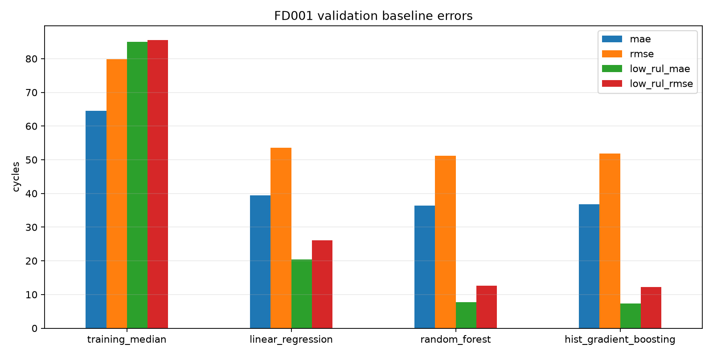

# FD001 Baseline Results

## Evaluation contract

These are development-validation results, not official test results. Complete
training trajectories for units 1–80 (16,138 rows) were used for fitting, and
complete trajectories for units 81–100 (4,493 rows) were used once for
validation. The target is uncapped linear RUL:

`max_cycle_for_unit - current_cycle`

All three operational settings and 21 current-cycle sensors were retained so
the first baseline comparison does not confound model choice with feature
selection. The linear-regression `StandardScaler` was fitted on the 16,138
training rows only. The random forest does not require scaling. No official test
features or RUL labels were used.

## Results

| Baseline | MAE | RMSE | MAE at RUL <= 30 | RMSE at RUL <= 30 | Negative predictions |
|---|---:|---:|---:|---:|---:|
| Training-median RUL (100) | 64.475 | 79.913 | 85.000 | 85.469 | 0 |
| Linear regression | 39.471 | 53.501 | 20.474 | 26.068 | 179 |
| Random forest | **36.369** | **51.203** | **7.737** | **12.655** | 0 |
| Histogram gradient boosting | 36.793 | 51.798 | **7.301** | **12.180** | 1 |

Exact machine-readable results and split metadata are stored in
`docs/baseline_metrics.json`.

## Engineering interpretation

- Both learned baselines beat the median sanity predictor, confirming that the
  current-cycle sensor state contains useful RUL signal.
- The random forest improves overall MAE by 7.9% relative to linear regression
  and reduces near-failure MAE by 62.2%. It is the baseline a sequence model must
  beat or operationally complement.
- Histogram gradient boosting did not beat the forest overall, but improved
  near-failure MAE by 5.6%. This confirms that aggregate and operationally
  critical regions can favor different models; both remain comparison points.
- Linear regression's 179 negative validation predictions show that unconstrained
  output is physically invalid near/beyond the learned boundary. Metrics here
  use raw predictions so this weakness is not hidden by clipping.
- The remaining overall RMSE of 51.2 cycles is large relative to near-failure
  RMSE. Early/mid-life uncapped RUL is harder for current-cycle features and may
  dominate aggregate error. This makes capped-target sensitivity worth testing,
  but does not authorize changing the primary target without a recorded result.
- This fixed unit-range validation is intentionally transparent. A deterministic
  grouped-fold robustness check should accompany model selection so conclusions
  do not depend only on units 81–100.

## Phase status

The simple-baseline requirement is complete. Sequence-model work may begin only
with the same unit isolation, training-only preprocessing, and explicit
comparison against the random-forest results above.

ML BASELINE STATUS: COMPLETE
