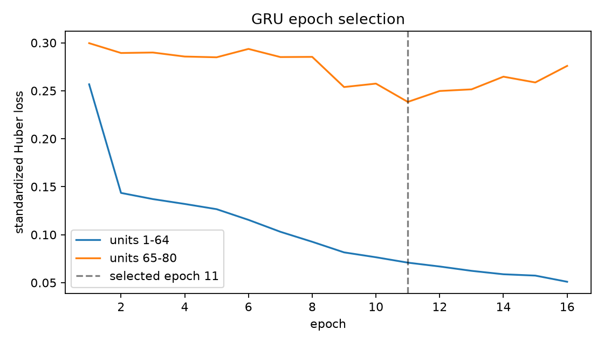

# FD001 Compact GRU Results

## Evaluation contract

The GRU uses 30-cycle windows, 24 settings/sensor features, training-only input
scaling, and uncapped linear RUL. Units 1–64 selected the training trajectory,
units 65–80 selected the epoch count, and units 81–100 were untouched until the
final development-validation evaluation. The selected 11 epochs were then
retrained from initialization on all units 1–80.

Configuration: one 32-unit GRU layer, a 16-unit ReLU head, 0.1 dropout, Huber
loss on standardized RUL, Adam at 0.001, batch size 256, deterministic seed 42.
The network contains 6,113 parameters.

## Results

| Model | MAE | RMSE | MAE at RUL <= 30 | RMSE at RUL <= 30 | Negative predictions |
|---|---:|---:|---:|---:|---:|
| Random forest | 36.369 | 51.203 | 7.737 | 12.655 | 0 |
| Histogram gradient boosting | 36.793 | 51.798 | 7.301 | 12.180 | 1 |
| Compact 30-cycle GRU | **26.492** | **40.777** | **4.890** | **6.829** | 10 |

Relative to the strongest overall tree baseline, the GRU reduces MAE by 27.2%,
RMSE by 20.4%, and low-RUL MAE by 36.8%. This is sufficient evidence that recent
temporal history adds value on the frozen validation engines.

Single-window CPU inference averaged 1.10 ms in the local benchmark. This is
well below any realistic cycle-level telemetry cadence, though service-level
latency must later include window assembly, validation, persistence, and API
overhead.

## Artifact and inference

`ml/artifacts/fd001_gru.pt` contains model weights, architecture settings,
feature order, window length, target definition, target normalization, and input
scaler statistics. `ml.models.gru.predict_raw_window` provides standalone
inference from one raw `(30, 24)` window without refitting preprocessing.

Exact metrics and training histories are in `docs/gru_metrics.json`.

## Limitations and decision

- Ten raw predictions were negative. They remain unmodified in reported metrics.
  The later inference boundary must enforce a documented non-negative output
  contract, while retaining raw output for monitoring.
- This is one deterministic development run, not a claim of broad superiority.
  Official test evaluation and additional seeds remain required before model
  promotion.
- A TCN is not tested now because the compact GRU already provides a material
  improvement. Additional architectures would add comparison breadth without
  solving a current project need.

SEQUENCE MODEL STATUS: COMPLETE FOR DEVELOPMENT
