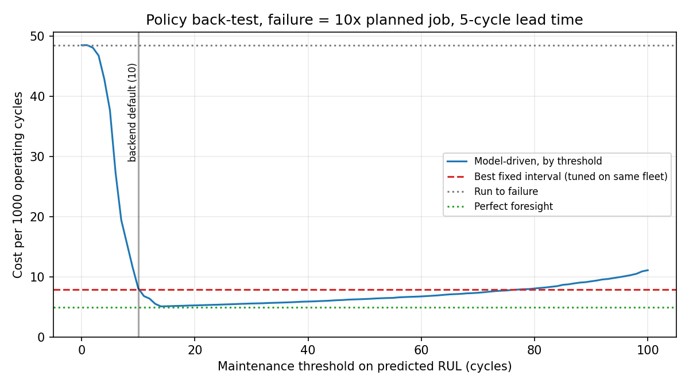

# FD001 Maintenance-Policy Back-Test

## Question

The platform raises a work order when predicted RUL falls to a threshold (10
cycles by default). Is that a sensible rule, and does acting on RUL predictions
beat the maintenance schedules a plant would otherwise use?

## Method

- **Predictions:** out-of-fold predictions from the CV-selected model (14
  sensors, window features, RUL capped at 125, histogram gradient boosting).
  Under grouped 5-fold CV every engine is scored by a model that never saw it.
- **Replay:** each of the 100 training engines is replayed cycle by cycle. A
  threshold policy fires at the first cycle where predicted RUL is at or below
  the threshold. Maintenance executes after a fixed lead time. If the engine
  fails first, it is a failure.
- **Cost metric:** cost per 1000 operating cycles. Planned maintenance and
  failure both renew the asset, so this is total cost over total cycles run.
  Cost per engine would make early replacement look free.
- **Baselines:** run to failure; a fixed interval (maintain every T cycles); and
  a perfect-foresight lower bound that maintains on the last cycle before failure.
- **Selection:** thresholds and intervals are chosen on the other folds' engines
  and applied to the held-out fold. "In-sample" rows choose on all 100 engines
  and are optimistic for both policies.
- **Primary scenario, declared before running:** a failure costs 10x a planned
  job, work orders take 5 cycles to execute, and one prediction below the
  threshold fires.

## Primary scenario

| Policy | Failures per 100 | Mean unused life (cycles) | Cost per 1000 cycles |
|---|---:|---:|---:|
| Run to failure | 100.0 | 0.0 | 48.47 |
| Fixed interval, T chosen on other engines (T = 127–134) | 1.0 | 78.8 | 8.49 |
| Fixed interval, best T on all engines (T = 127, optimistic) | 0.0 | 79.3 | 7.87 |
| Model, backend default threshold (10) | 7.0 | 5.0 | 8.08 |
| **Model, threshold chosen on other engines (13–14)** | **1.0** | **8.7** | **5.51** |
| Model, best threshold on all engines (14, optimistic) | 0.0 | 8.9 | 5.07 |
| Perfect foresight (lower bound) | 0.0 | 1.0 | 4.87 |

The model-driven policy costs **35.1% less than the best fixed interval**
(paired bootstrap 95% interval over engines: 19.8% to 48.3%) and 88.6% less than
running to failure. It closes 82% of the gap between the fixed interval and the
perfect-foresight bound, and throws away 8.7 cycles of life per job against 78.8.



The curve is lopsided. Below about 10 cycles the cost climbs steeply because jobs
start too late. From 11 to 77 cycles the model beats the best fixed interval, and
above that the cost rises slowly as maintenance gets earlier.

## Sensitivity (single trigger)

Cost per 1000 cycles, with the fixed interval and model threshold both chosen on
other engines. "tau=10 failures" is today's backend default applied to this model.

| Failure : planned | Lead (cycles) | Fixed | Model | Saving | Model failures per 100 | tau=10 failures per 100 |
|---:|---:|---:|---:|---:|---:|---:|
| 5 | 0 | 8.50 | 5.22 | 38.6% | 1.0 | 0.0 |
| 5 | 5 | 8.50 | 5.26 | 38.1% | 1.0 | 7.0 |
| 5 | 10 | 8.50 | 5.31 | 37.5% | 1.0 | 66.0 |
| 10 | 0 | 8.49 | 5.47 | 35.5% | 1.0 | 0.0 |
| 10 | 5 | 8.49 | 5.51 | 35.1% | 1.0 | 7.0 |
| 10 | 10 | 8.49 | 5.57 | 34.4% | 1.0 | 66.0 |
| 20 | 0 | 9.27 | 5.98 | 35.5% | 1.0 | 0.0 |
| 20 | 5 | 9.27 | 6.02 | 35.1% | 1.0 | 7.0 |
| 20 | 10 | 9.27 | 6.08 | 34.4% | 1.0 | 66.0 |
| 50 | 0 | 11.61 | 7.48 | 35.5% | 1.0 | 0.0 |
| 50 | 5 | 11.61 | 7.54 | 35.1% | 1.0 | 7.0 |
| 50 | 10 | 11.61 | 7.61 | 34.4% | 1.0 | 66.0 |

Requiring 3 consecutive sub-threshold predictions was also run. It was worse at
zero lead (saving 14.2% to 36.1%, 2 failures per 100) and better at leads of 5 and
10 cycles (saving 40.6% to 56.5%, no failures). The single-trigger rule stays the
primary result because it was declared first. All scenarios are in
`docs/policy_backtest.json`.

## What this supports

- **The saving is robust to the assumptions.** Across every failure-to-planned
  ratio and lead time tested, the model-driven policy saves 34% to 39% against
  the best fixed interval.
- **The default threshold of 10 is only safe if work orders execute almost
  immediately.** With a 5-cycle lead it fails 7 engines in 100, and with a
  10-cycle lead it fails 66 in 100. The threshold chosen on other engines tracks
  the lead time: 7–8 at zero lead, 13–14 at 5 cycles, 18–21 at 10 cycles, roughly
  lead plus 9.
- **Err on the high side.** A threshold that is too low is expensive and one
  that is too high is cheap, so a margin above the cost minimum costs little.

## Recommendation (needs your decision; the backend is unchanged)

Set the work-order threshold (`RUL_CRITICAL_THRESHOLD`) from the real lead time
of your maintenance process, at about lead plus 10 cycles. For a 5-cycle lead
that is around 15. If the lead time is unknown, treat 10 as too low. Re-tune it
when a different model is promoted, since it depends on that model's error.

## Caveats

- FD001 is simulated and clean. The costs and lead times are illustrative
  assumptions, so read this as a method, not a field result.
- The predictions come from the CV-selected tree model, not the promoted GRU the
  backend serves. The default-threshold row applies today's threshold to this
  model's predictions.
- Thresholds and intervals are chosen on other folds' engines, but those engines'
  predictions came from models trained on the held-out fold. That second-order
  leak is small. The bootstrap resamples engines with the chosen values held fixed.
- The fixed-interval baseline is tuned with knowledge of this fleet's lifetime
  distribution, which makes it stronger than a typical real schedule.
- 100 engines is a small sample. One extra failure adds about 0.5 to a cost rate
  near 5, which is why small gaps between rows are not meaningful.
- Every job is a perfect renewal, with no crew limits, spares or partial repairs.

## Reproduce

```powershell
python scripts/run_fd001_policy_backtest.py
pytest -q tests/test_policy.py
```

Set `EVAL_CACHE_DIR` to a folder outside the repository to cache the
out-of-fold predictions.
